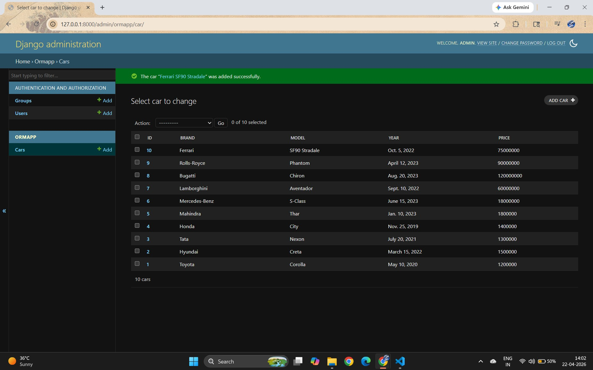
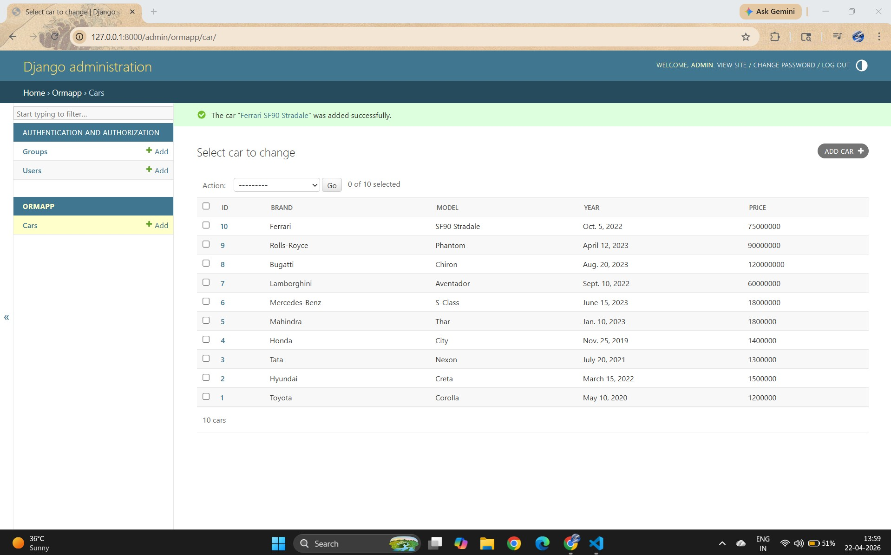

# Ex01 Django ORM Web Application
# Date:20.04.2026
## Name: K.SriSaran Karthik
## Reg No: 212224230275
# AIM
To develop a Django application to store and retrieve data from a bank loan database using Object Relational Mapping(ORM).
# ENTITY RELATIONSHIP DIAGRAM


# DESIGN STEPS
## STEP 1:
Clone the problem from GitHub

## STEP 2:
Create a new app in Django project

## STEP 3:
Enter the code for admin.py and models.py

## STEP 4:
Execute Django admin and create details for 10 cars

# PROGRAM

## 1.ADMIN.PY
```PYTHON
from django.contrib import admin
from .models import Car

class CarAdmin(admin.ModelAdmin):
    list_display = ('id', 'brand', 'model', 'year', 'price')

admin.site.register(Car, CarAdmin)

```

## 2.MODELS.PY

```PYTHON
from django.db import models

class Car(models.Model):
    id = models.IntegerField(primary_key=True)
    brand = models.CharField(max_length=15)
    model = models.CharField(max_length=30)
    year = models.DateField()
    price = models.IntegerField()
    car_type = models.CharField(max_length=10)

    def __str__(self):
        return f"{self.brand} {self.model}"
        
```

# OUTPUT





# RESULT
Thus the program for creating a database using ORM hass been executed successfully
